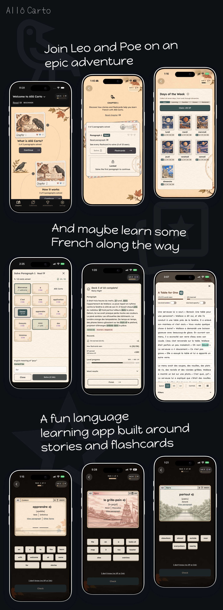

# Allô Carto

Hello! Allô Carto is a story drive mobile flashcard app I've been building focused around progressing users through stories one paragraph at a time using flashcards and solving puzzles to learn Quebec French.

## A note about AI

Allô Carto is not a vibe coded project. Months went into developing the core systems without any AI assistance. This includes the way context is used throughout the app, the database interface, the word data schemas, progression mechanics, and more. Building these systems myself has proved crucial to the project.

Copilot has been used increasingly in later development for refactoring, creating components, and general convenience.

AI stylized images, originally created from my own photographs using Affinity, are no longer used and will be removed from the project.

All remaining AI generated placeholders will also be removed. New illustrations will be hand drawn, digitized, and edited in Affinity and Procreate without AI tools.

Illustrations are an enormous challenge for me. I'm not a very good artist. But I do believe in this project enough to take that challenge on and give it my best.

If you’re an artist and are interested in contributing, I’d love to hear from you. message.bryan.gh@outlook.com

## Built with

- [Expo](https://expo.dev/) and [React Native](https://reactnative.dev/)
- TypeScript and Expo Router
- SQLite for on-device vocabulary and progress data
- Jest and React Native Testing Library for tests

## Pronunciation notes

Text to speach has been added and it uses `fr-CA`. Also, we now have IPA pronunciations!

Settings offers **Readable pronunciation** (the default) and **IPA**. Both formats cover the complete French text shown on the card, including its article and applicable liaison or elision.

Each word stores these (in props) as `pronunciation` and `ipaPronunciation`. Update both together when adding or correcting a word.

Vowels in readable pronunciation are written like this:

- `an` / `en`: `ahn`
- `on`: `ohn`
- `in` / `ain` / `ein`: `an`
- `un`: `uhn`

The final `n` is generally there to suggest a French nasal sound. It is included often because these guides favor being approachable over exact. That's what IPA is for.

### Copyright

IPA transcriptions are informed by the Québec French pronunciation dictionary by **Marie-Hélène Côté, Université de Lausanne**, converted to the SPPAS format and SAMPA by **Brigitte Bigi, CNRS, Laboratoire Parole et Langage**. They include editorial transcriptions for missing words, inflections, expressions, and context-dependent senses. These estimates are not presented as dictionary-verified or official pronunciations. Per-word provenance, retained dictionary source entries, copyright notices, and license terms are in [data/french/pronunciations](data/french/pronunciations/README.md).

## Fonts

**Lexend**: interface and readable pronunciations. **Azeret Mono**: rank/CEFR labels.

**Noto Sans Regular**: IPA (Lexend lacks required symbols). [License](src/app/assets/fonts/NotoSans-OFL.txt).

Fonts live in `src/app/assets/fonts/`, loaded with Expo's `useFonts`.

[Adding custom fonts in React Native](https://blog.logrocket.com/how-to-add-custom-fonts-react-native/)
